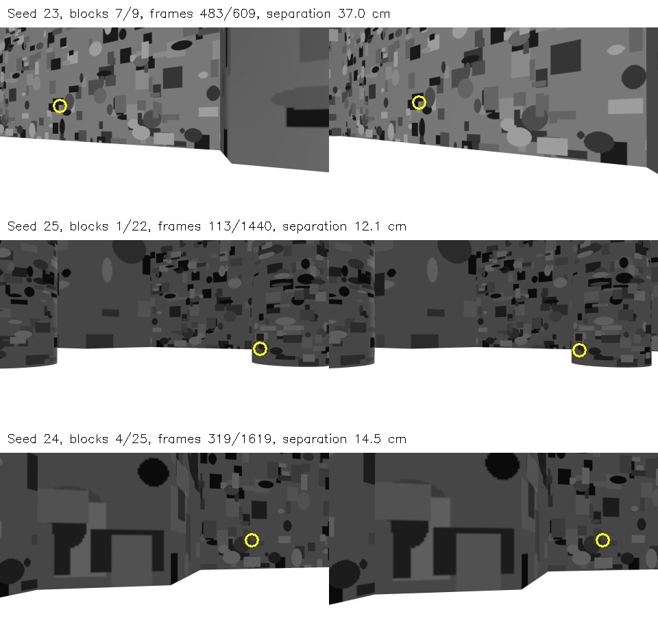

# Shutdown regression validation and exploratory submap diagnosis

Executed on the Dell Vostro 3710 on 12 October 2026. This follow-up completes the
shutdown regression and fixed-data diagnosis phase. It does not complete the
paper, introduce a corrected global map, or constitute a new autonomous mission.

## Software correction and direct evidence

The old controller and supervisor both signaled the vision process. A second
signal could interrupt its final serialization. The viewer also called
rclpy.shutdown after the default ROS signal handler had invalidated the context.
The correction makes the supervisor the owner of sensor shutdown and uses
cooperative Python signal handlers with ROS automatic signal handling disabled.
The context remains valid until callbacks and final saving have finished.
Cleanup calls are idempotent and escalation is recorded.

The vision node replaces each complete output file atomically and writes a final
save marker. This prevents partial individual files during the tested stop path;
it does not promise a transactional multi-file snapshot or recovery from power
loss. The supervisor closes its viewers instead of leaving them for the outer
campaign wrapper, and detects premature exits of required mission processes.
The campaign wrapper gives the supervisor time to clean up before terminating
remaining owned descendants. Triangulation, sensor inputs, point acceptance
thresholds and published historical maps have not been changed.

The real-process ROS regression suite ran in domain 176 without Gazebo or an
autonomous controller. It deliberately delayed final saving by 350 ms to deliver
additional SIGINT/SIGTERM requests inside the save path. This is an adversarial
test fixture, not a representative shutdown-time benchmark.

| Check | Observed result |
| --- | --- |
| Original vision, second signal during final save | Failure reproduced: KeyboardInterrupt, exit -2 |
| Original viewer, ordinary SIGINT | Failure reproduced: duplicate rcl_shutdown, exit 1 |
| Patched vision, run 1 data | Exit 0; 2,027 frames and 72,922 tracks preserved |
| Patched vision, run 2 data | Exit 0; 1,868 frames and 61,952 tracks preserved |
| Patched vision, run 3 data | Exit 0; 1,956 frames and 71,666 tracks preserved |
| Patched viewer, three separate processes | All exited 0 without traceback |
| Patched odometry node | Exit 0 without traceback |
| Cooperative child, stop called twice | One SIGINT, exit 0 |
| Deliberately unresponsive disposable child | Bounded SIGINT/TERM/KILL escalation recorded; exit -9 |

All 11 checks passed their declared expectation, including the two expected
failures of the original code. The suite took 18.99 wall seconds on the Dell.
Parsed keyframe and track content was equal to the source recording in every
patched vision test; there were no leftover temporary files. No archived
recording was overwritten.

A separate test exercised the actual command watchdog and audit together. The
independent observer received 13 zero commands before stopping the watchdog and
16 in total; no nonzero command was sent. The audit wrote its terminal record
with last command [0, 0]. Both processes exited 0, with no escalation. This tests
the isolated stop path, not motor behavior or a complete Gazebo mission.

Limits: the complete revised supervisor/campaign sequence has not yet been
rerun in Gazebo. The historical Python message-conversion exception was not
independently reproduced under load. A bounded integration mission remains
required before new comparative SLAM experiments.

## Fixed-data submap diagnosis

The diagnostic reads the unchanged three recordings and the frozen RGB
associations from the 8 October audit. It changes neither maps nor associations.
It separates horizontal and vertical disagreement, compares coordinates before
and after the existing planar graph warp, and asks whether a planar rigid
transform fitted on other landmarks predicts held-out correspondences.

For each block pair, connected components of shared landmark IDs stay in the
same fold. Three folds are assigned deterministically without using residuals.
Fits need at least six training and three test pairs plus nondegenerate XY
spread. Scale and height are never fitted; there is no distance-based rejection.
This separates landmark identities, not independent journeys, camera poses or
spatial neighborhoods. Repeated textures can still yield incorrect associations.

| Seed / block pair | Pairs | Original held-out median range (cm) | After diagnostic planar fit (cm) |
| --- | ---: | ---: | ---: |
| 23 / 3–23 | 19 | 6.23–6.69 | 0.64–1.08 |
| 24 / 4–24 | 93 | 3.57–4.16 | 0.74–1.33 |
| 24 / 4–25 | 102 | 1.52–1.85 | 0.81–1.25 |
| 25 / 1–22 | 20 | 12.00–12.37 | 1.91–2.82 |

Each range spans the three fold medians, not a confidence interval. These
reductions support a coherent planar misalignment component in these selected
block pairs. They are not results from an improved SLAM system, and do not
establish true geometric accuracy.

The existing graph warp is not uniformly helpful. For seed 25, blocks 1/22 have
median separation 8.43 cm before the warp and 12.06 cm afterward. In seed 24,
blocks 4/25 improve from 5.32 to 1.65 cm. Disabling graph correction globally is
therefore not justified by this evidence.

The largest seed-23 discrepancy remains unresolved: blocks 7/9 have eight
associated pairs, with median separation 31.78 cm before the warp and 31.85 cm
afterward (maximum 36.99 cm afterward). This pair lacks the declared support for
cross-validation and is retained, not deleted. Local pose/triangulation bias and
incorrect visual association remain possible explanations; the current data
does not isolate them. Vertical medians are below 0.5 cm in the four scored
block pairs, while disagreement is predominantly horizontal.

## Association support and visual inspection

The earlier stricter subset required an epipolar check in at least one image
pair plus repeated image support. Requiring epipolar support in two temporally
separated image pairs leaves 17/40, 184/195 and 16/20 pairs for seeds 23/24/25.
Their p90 separations are 6.93, 5.00 and 13.98 cm respectively. These are
additional exploratory subsets, not replacements for the published metrics.
In particular, removing weakly supported matches is not the same as fixing a
map, and the smaller subset can omit the worst unexplained region.

The figure shows the largest seed-23 separation, a median seed-25 example and
the largest seed-24 separation. Yellow circles locate the saved RGB observations;
they do not certify feature identity. The inspection confirms that repeating
geometric textures complicate correspondence verification. It provides no
independent metric reference and is not a ground-truth labeling exercise.

## Next bounded study

1. Run one fresh, short Gazebo integration mission with the revised shutdown
   code; require complete final files, no unexpected child exit, no shutdown
   escalation, simulator pause, and terminal zero commands.
2. Expand and independently review image correspondence support around seed-23
   blocks 7/9 before introducing a global correction. Do not use held-out pixels
   to choose acceptance thresholds or discard the high-error region.
3. Evaluate a visual constraint between submaps on fixed recorded inputs, keeping
   the old maps and recording all failed associations and degenerate cases.
4. Freeze a new protocol before sensor ablations and a matched low-texture
   condition. Preserve the Dell as the execution platform and report resource
   failures. This follow-up has not measured an individual sensor's benefit.

## Reproduction and evidence

- [Shutdown tests](../tools/validate_shutdown.py) and [zero-command/audit test](../tools/validate_stop_audit.py).
- [Read-only submap diagnostic](../tools/diagnose_submaps.py).
- [Shutdown result](../results/shutdown-20261012.json), [watchdog result](../results/stop_audit-20261012.json), and [complete diagnostic](../results/submaps-20261012.json).
- [Raw shutdown logs and visual-example metadata](../results/shutdown-logs-20261012.json).
- Test outputs and logs remain under /home/lpviana/tb3_followup_20261012 on the Dell.
- Original inputs remain under /home/lpviana/tb3_publication_campaign_20261007.
- Sensor policy is unchanged: RGB triangulation for height; planar LiDAR,
  wheel velocity and raw gyro/accel support pose; no depth, compass, IMU
  orientation or simulator geometry/pose as estimator input.

From a sourced Jazzy shell, place the revised runtime under ROOT/runtime and
the unmodified campaign runtime under ROOT/baseline, then use fresh output paths:

    python3 tools/validate_shutdown.py ROOT CAMPAIGN
    python3 tools/validate_stop_audit.py ROOT
    python3 tools/diagnose_submaps.py CAMPAIGN ROOT/results/submaps

The tests refuse existing output directories. Original source hashes are retained
in the replication archive; revised source hashes are in the shutdown result.
This report documents an engineering validation and exploratory diagnosis, not
publication readiness.
