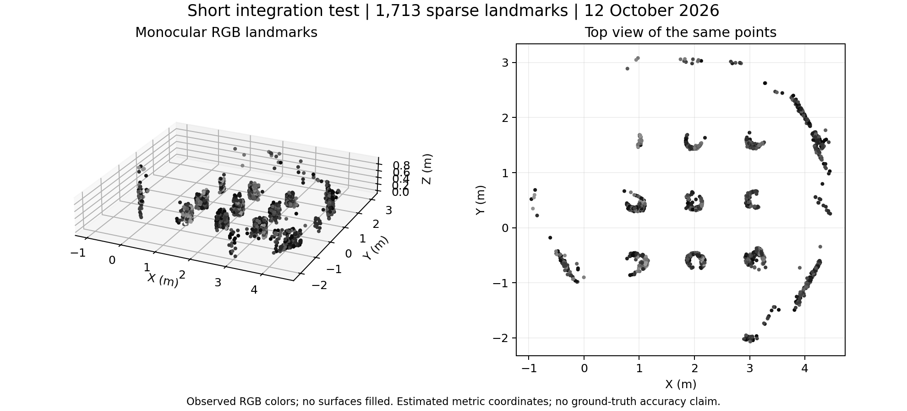

# Short live Gazebo integration validation

On 12 October 2026, the revised system completed one bounded autonomous Gazebo
mission on the original Dell Vostro 3710. All 31 execution and data-integrity
checks passed. Every supervised child exited with code zero; no shutdown
escalation, Python traceback or duplicate ROS shutdown was observed. The
simulation was paused and no observed owned process remained alive afterward.

This closes the short live-integration gate left open by the
[shutdown regression report](followup-report-20261012.md). It does not establish
complete mapping, absolute geometric accuracy, sensor benefit or publication
readiness. Six transport losses and two large held-out pixel residuals are
retained below.

## Scope and execution

The [protocol](../docs/integration-protocol-20261012.md) was written on the Dell
and hashed before execution. Its later GitHub upload is not an external
preregistration. A fresh directory reused the archived textured scene, seed 23,
and the revised runtime. ROS domain 76 and a separate Gazebo partition isolated
the experiment. Scene files were supplied only to Gazebo.

The supervisor gained a bounded `TB3_MISSION_SECONDS` setting, retaining the
2400-second default. This test used 180 seconds of navigation and a 1200-second
outer mission deadline. Reconstruction thresholds, sensor inputs and planning
logic were unchanged. The existing campaign resource monitor was reused.

Execution ran from 13:14:42 to 13:19:11 UTC (10:14:42–10:19:11 in Maceió).
The controller stopped at its navigation budget and completed final fitting
afterward. Its total session was 219.7 seconds; the outer process ran for about
270 seconds including startup and cleanup. This distinction prevents confusing
navigation time with total experiment cost.

| Observation | Result |
| --- | ---: |
| Estimated distance traveled | 9.35 m |
| Goals reached / failed goals | 14 / 0 |
| Planned views covered | 25 / 152 (16.45%) |
| Final estimated distance from start | 1.55 m |
| Saved keyframes / tracks | 395 / 12,685 |
| Accepted sparse landmarks | 1,713 |
| Recorded messages / topics | 558,281 / 10 |
| Maximum sampled RViz instances | 1 |
| Minimum sampled available RAM | 2,796.84 MiB (2.73 GiB) |
| Maximum sampled owned-process PSS | 1,533.19 MiB |
| Navigation real-time factor, median | 0.890 |
| Minimum free disk | 14.62 GiB |

The actual stop reason was `time_budget_reached_incomplete`. The robot began
returning toward its estimated start but did not arrive before the short budget.
Neither home return nor complete environment coverage is claimed. Planned-view
coverage is not surface coverage, and distance is estimated rather than ground
truth. One RViz was opened and then closed by the supervisor.

The physical platform remains the i5-12400 / 8 GiB / Intel UHD 730 Dell. The
observed kernel for this run was 7.0.0-34-generic. No resource gate aborted this
test. Five-second resource samples do not measure continuous peaks; swap usage
was approximately 477.51 MiB at both first and last samples. The real-time factor
is derived from simulation clock progress, not per-image processing latency.

## Shutdown and recording evidence

The controller, vision node, recorder, viewer, RViz, odometry, SLAM, image bridge,
sensor bridge and audit process all exited zero. The watchdog also exited zero.
The supervisor sent one SIGINT to each sensor/viewer child and needed no SIGTERM
or SIGKILL. Vision completed final saving about 0.46 seconds after its stop
request in this run. These timings are one observation, not latency bounds.

The independent command observer saw 3,535 commands, ending with [0, 0]. Only
the autonomy and watchdog frame identifiers were observed. Maximum absolute
commanded speeds were 0.085 m/s and 0.32 rad/s. The raw bag contains 3,533
commands; differing capture windows and the recorded transport-loss warning
prevent treating the two streams as losslessly identical.

Every stored MCAP message was traversed, and all per-topic counts matched the
bag metadata. The first and last compressed RGB images decoded to 1920 × 1080.
The recorder explicitly reported **six transport-layer messages lost**; metadata
agreement verifies stored contents, not zero acquisition loss. The affected
topics and cause were not isolated, so this is not attributed to the Dell's
hardware. The bag occupies 949,535,332 bytes including metadata and remains on
the Dell, with SHA-256 hashes recorded in the audit.

Final JSON files parsed, frame and track counts matched the save marker, PLY
coordinates and RGB values matched the landmark JSON, and the final fit used
all 395 saved frames. Seven reconstruction blocks converged. No archived run
was overwritten.

## Reconstruction evidence and unresolved observations

Only monocular RGB triangulation supplies height. Wheel velocity, raw gyro and
accelerometer measurements, and planar LiDAR support pose. No RGB-D/depth,
compass, IMU orientation field, simulator ground-truth pose or scene geometry
was consumed by the estimator/controller. The flat-floor pose prior and
approximate placement of rigid visual submaps remain limitations.

The final map contains 1,713 landmark IDs, including 1,369 above 0.08 m in its
estimated frame. IDs can duplicate physical features. No missing surfaces are
filled, and colors are inherited from tracked RGB pixels.

| Reserved observations at 960 × 540 working resolution | Result |
| --- | ---: |
| Scored pixel observations | 4,108 |
| Median residual | 0.278 px |
| 90th percentile | 0.847 px |
| Maximum residual | **176.884 px** |
| Residuals above 3 px / above 8 px | 10 / 2 |

The two largest residuals belong to track 7759, block 1, frame 114 (176.884 px),
and track 18191, block 3, frame 209 (125.507 px). Other reserved observations
and validation observations in those tracks have much smaller residuals. This
pattern motivates checking endpoint correspondences and pose support, but does
not itself prove the cause. The complete
[outlier records](../results/integration-outliers-20261012.json) are retained;
no points were removed or refitted after inspecting reserved errors.

The existing aggregate pixel gate passes because it uses median and p90. That
gate therefore does not imply an absence of catastrophic individual residuals.
An engineering integration pass must not be presented as uniformly accurate
reconstruction. These observations are now development evidence; any changes
informed by them need fresh, untouched evaluation data.

The earlier approximately 32 cm disagreement between seed-23 submaps 7/9 also
remains unresolved. This short run does not retest that region or supersede
the three-run replication metrics. Sensor ablations and matched low-texture
experiments have not yet been performed.

## Reproduction and next work

The [integration runner](../tools/integration_runner.py) reuses the
[campaign monitor](../tools/campaign_runner.py). Prepare a new root containing
`repeat_01/` with the revised runtime, `scene/` with the archived scene, and
`PROTOCOL.md`. From a sourced Jazzy shell with the desktop display environment:

    python3 tools/integration_runner.py ROOT
    python3 tools/audit_integration.py ROOT

The runner and auditor preserve existing output directories. Do not reuse
historical process IDs to control current processes. The
[audit](../results/integration-20261012.json) includes protocol/source hashes,
checks, resource summaries, bag hashes and process outcomes; the
[process logs](../results/integration-logs-20261012.json) retain warnings.
The [PLY map](../data/integration-map-20261012.ply) and
[plot script](../tools/plot_integration.py) reproduce the figure without ROS.
Full raw inputs remain under `/home/lpviana/tb3_integration_20261012` on the Dell.

The next scientific work is to inspect the two visual outliers and the earlier
weakly supported submap associations, then freeze a revised method before new
evaluation recordings and sensor ablations. The current evidence supports a
successful short integration test with preserved limitations, not a claim that
the entire SLAM experiment is ready for publication.
