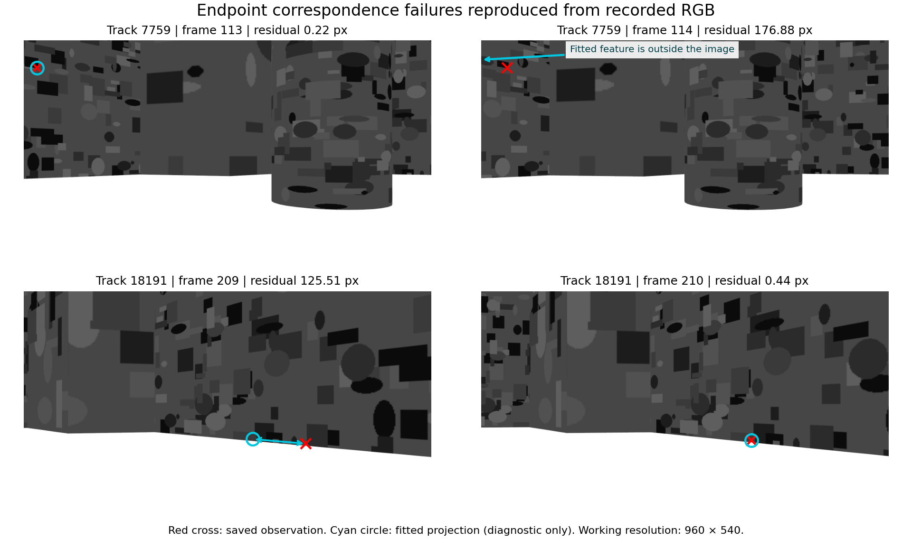
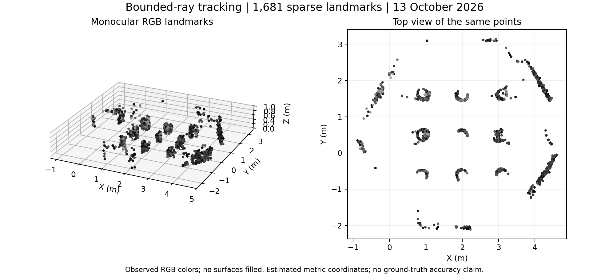

# Bounded-ray tracking: diagnosis, tradeoffs and a fresh Gazebo test

On 13 October 2026, a geometric check was added to temporal RGB tracking after
two large pixel errors were reproduced exactly from the preserved 12 October
recording. A new, bounded autonomous Gazebo execution then passed all 31
integration checks and the visual-tail criterion fixed before that execution.
It reconstructed 1,681 sparse landmarks with a maximum reserved-pixel residual
of 5.379 px. However, the recorder reported **344 transport-layer messages lost**,
available RAM fell to 1.71 GiB, and the earlier approximately 32 cm discrepancy
between submaps remains unresolved. These findings support a specific tracking
repair and short integration result, not complete mapping or publication readiness.

## Diagnosis using the preserved recording

The unchanged baseline was refitted for the affected blocks without deleting
observations or changing acceptance. Both reserved-error vectors were reproduced
exactly. Original compressed camera messages were decoded from MCAP and resized
with the original preprocessing; the diagnostic did not replay recompressed
saved JPEGs.

| Historical track | Failed transition | Original maximum residual | LK forward/backward error | Other accepted tracks at the affected pose |
| --- | --- | ---: | ---: | --- |
| 7759 | frames 113 to 114 | 176.884 px | 0.549 px | 62 observations; median 0.177 px, maximum 0.855 px |
| 18191 | frames 209 to 210 | 125.507 px at frame 209 | 0.290 px | 27 observations; median 0.329 px, maximum 1.187 px |

Both incorrect transitions passed the existing LK status, photometric and
forward/backward checks. For track 7759, the fitted feature had left the image,
but LK continued the ID onto an interior feature. For track 18191, the first
transition associated the initial feature with a different location. The low
errors of other tracks at those poses argue against a general pose failure
as the explanation for these two extremes. This is evidence of incorrect
correspondence under the recorded pose model, not simulator identity ground truth.

The fused-pose bounded-ray distances for the two transitions were 169.273 and
124.232 px in the forward direction, and 149.229 and 118.456 px in reverse.
The records are retained in the [diagnosis](../results/tracking-diagnosis-20261013.json)
and [compact regression fixtures](../data/ray-gate-fixtures-20261013.json).
LK photometric output is reported as null when its status is invalid, because
that output is not a meaningful measurement for a failed track.

## The implemented change

The new [ray gate](../runtime/ray_gate.py) checks each proposed temporal
correspondence before the node appends it to a track. A ray from the previous
RGB pixel is transformed into the current camera using the fused camera poses.
Its optical depth is restricted to 0.15–6 m in **both** cameras, matching the
triangulator's working range. The positive-depth interval projects to an image
segment. The implementation computes distance to that entire segment analytically,
rather than sampling a set of depths. Both directional distances must be at most
12 px at the 960 × 540 working resolution.

This gate rejects associations; it does not generate point heights. Reconstruction
still triangulates monocular RGB rays. Wheel velocity, raw gyro/accelerometer
measurements and planar LiDAR support pose. No depth/RGB-D, compass,
IMU orientation field, simulator pose or scene geometry is consumed by the
estimator/controller. The scene files remain inputs to Gazebo only.

The 12 px tolerance is an engineering heuristic, not a calibrated uncertainty
bound. A bad pose prior can reject a correct correspondence. Existing LK,
temporal-gap, image-border, bundle-adjustment and triangulation settings were
retained. Rotation initialization was probed diagnostically but not added to
the deployed candidate, keeping this change limited to the geometric check.

Seven analytic test cases passed on the Dell before the new live test, including
known projected points, pure rotation, depth clipping, wrong parallax, invalid
inputs and invariance to the world coordinate frame. The recorded two-transition
regression also passed. The final portable suite has eight test methods, with
the two recorded failures checked as subcases of the eighth; all passed in the
packaging workspace. Its result is included in the evidence archive.

## Development replay: improvement with costs

The actual baseline node's image-processing method was replayed on all 395
recorded keyframes, using the original compressed RGB and fixed recorded pose,
calibration and frame schedule. It reproduced all 12,685 stored tracks **exactly**.
No ROS node or velocity publisher was started. The candidate then processed the
same input sequence; reconstruction settings were unchanged.

| Measure | Preserved baseline | Candidate replay |
| --- | ---: | ---: |
| Frames | 395 | 395 |
| Stored tracks | 12,685 | 12,969 |
| Accepted landmark IDs | 1,713 | 1,603 |
| Scored reserved observations | 4,108 | 3,897 |
| Median residual | 0.278 px | 0.283 px |
| 90th percentile | 0.847 px | 0.866 px |
| Maximum residual | 176.884 px | 7.640 px |
| Residuals above 3 px | 10 | 15 |
| Residuals above 8 px | 2 | 0 |

The candidate rejected 2,064 proposed track continuations and retained 110 fewer
landmark IDs (6.42% fewer). Median and p90 did not improve, and the count above
3 px increased. Replay processing medians were approximately 34.4 and 35.0 ms
per selected frame; these sequential offline timings are descriptive, not a
live throughput benchmark or a controlled performance comparison.

The recording was already inspected during development. Moreover, changed
tracking changes IDs and their deterministic train/validation/test partitions.
Consequently, the aggregate residuals are not errors on an identical set of
held-out pixels. They demonstrate behavior of the implemented repair on
development data and must not be presented as independent generalization.
The [replay record](../results/tracking-replay-20261013.json) explicitly qualifies
the reconstructor's internal `parameters_predeclared_before_test` flag: it refers
to its within-track fit, not independence of this frontend development experiment.

## One fresh execution after fixing the candidate

The [protocol](../docs/ray-gate-protocol-20261013.md) was saved and hashed on the
Dell before launch. Its later GitHub upload is not external preregistration.
The candidate source hashes match those used in the new recording. No thresholds
were changed after viewing its results, and no repeat run replaced this outcome.

Execution used seed 26, ROS domain 77 and Gazebo partition
`tb3_ray_gate_live_20261013`. It ran from **14:39:52 to 14:45:53 UTC**, or
11:39:52–11:45:53 in Maceió. Navigation had a 180 s budget; the controller session
lasted 311.8 s including final fitting, and the outer execution lasted about
361 s including startup and cleanup. A first asynchronous fit took 146.30 s;
the final fit took 96.95 s and reused two cached blocks. All seven final blocks
converged and all 397 captured frames were included.

| Fresh-run observation | Result |
| --- | ---: |
| Estimated distance traveled | 9.65 m |
| Goals reached / failed / recoveries | 9 / 0 / 0 |
| Planned views visited | 28 / 152 (18.42%) |
| Final estimated distance from start | 1.87 m |
| Captured keyframes / stored tracks | 397 / 13,724 |
| Rejected temporal continuations | 1,607 |
| Accepted sparse landmark IDs | 1,681 |
| Reserved observations | 3,947 |
| Median / p90 / maximum residual | 0.265 / 0.816 / 5.379 px |
| Residuals above 3 / 8 px | 12 / 0 |
| Accepted landmarks with no scored reserved observation | 0 |

The predeclared visual-tail criterion required at least 30 scored observations,
no unscored accepted landmarks, and no residual above 8 px. All three conditions
passed. The run ended with `time_budget_reached_incomplete`; the retained
`terminal_reason` field uses the controller's broader resource-budget label.
No memory/disk guard aborted the run. It started returning toward the estimated
origin but did not arrive within the navigation budget. View coverage is not
surface coverage. This fresh recording is in the same previously studied scene
and is not a paired live baseline/candidate experiment.

The [PLY map](../data/ray-gate-map-20261013.ply) contains observed colors without
surface filling. Its 1,681 IDs include 1,376 above 0.08 m in the estimated frame;
IDs can duplicate physical features. Absolute geometric accuracy is unmeasured.

## Execution integrity, recording losses and modest hardware

All 31 existing integration checks passed. All ten supervised children exited
zero; the watchdog also exited zero. There were no observed Python tracebacks,
shutdown escalations or surviving owned mission processes. The simulator was
paused before cleanup. The independent observer and the bag each contained
5,358 velocity commands; the final observed command was [0, 0]. One RViz was
observed and closed by the supervisor. The mission is no longer running.

The bag contains **755,802 stored messages across ten topics**, spanning 306.778
simulation seconds and 1,271,414,188 bytes including metadata. Both MCAP segments
were traversed and per-topic counts matched metadata. Endpoint RGB images decoded
to 1920 × 1080. The final recorder log nevertheless reported **344 transport-layer
messages lost**. Stored-message consistency does not establish lossless acquisition.
The affected topics and cause were not isolated; the losses cannot yet be
attributed to the candidate, the CPU, RAM, disk, or bag-file splitting.

| Dell Vostro 3710 observation | Result |
| --- | ---: |
| Platform | i5-12400, 8 GiB RAM, Intel UHD 730 |
| Kernel | 7.0.0-34-generic |
| Minimum sampled available RAM | 1,748.25 MiB (1.71 GiB) |
| Maximum sampled sum of owned-process PSS | 1,664.83 MiB |
| Swap at first / last resource sample | 525.73 / 774.17 MiB |
| Minimum free disk | 13.09 GiB |
| Navigation real-time factor, median | 0.882 |
| Navigation system CPU, median | 55.8% |

The 75 resource samples were spaced approximately five seconds apart and do not
capture continuous peaks. PSS covers observed descendants, not all system RAM.
Real-time factor is simulation progress, not per-image latency. The lower memory
headroom, higher swap occupancy, long fitting intervals and recorder losses are
material observations for this hardware-centered experiment, even though no
resource abort occurred. The remaining disk space and the 6 GiB stop reserve
also constrain retention of further long recordings.

One launch wrapper failed before starting the mission because its user-session
bus environment was absent. Setting the runtime directory and session bus for
the same user allowed retrieval of the desktop display environment. This setup
failure is retained in the audit; it did not create an extra mission recording.

## The submap discrepancy is still open

The eight seed-23 associations between blocks 7 and 9 still have a median
separation of approximately 31.85 cm. For frames 483/609, the earlier audit had
33 mutual descriptor matches and 29 fundamental-matrix inliers. The second
image pair, frames 474/605, had only ten matches: below the audit's twelve-match
minimum. Its fundamental matrix was **not estimated**. The stored false support
flag therefore means lack of tested support in that pair, not a geometric
contradiction. Removing those associations would conceal an unresolved result.

The new tracking gate has not been used to rerun the complete historical
trajectory or align its submaps. This short seed-26 trajectory does not resolve
global placement, association ambiguity, or drift in that region. No corrected
global-map accuracy claim is made.

## Evidence, reproduction and remaining work

- [Tracking diagnosis](../results/tracking-diagnosis-20261013.json),
  [development replay](../results/tracking-replay-20261013.json), and
  [follow-up checks](../results/ray-gate-followup-20261013.json).
- [Full live integration audit](../results/ray-gate-live-20261013.json) and
  [process logs](../results/ray-gate-logs-20261013.json), including adverse findings.
- [Compact RGB evidence](../data/tracking-evidence-20261013.zip): four decoded
  working-resolution PNGs, failure fixtures, diagnosis, test output and hashes.
- [Diagnostic tool](../tools/diagnose_tracking.py),
  [actual-node replay](../tools/replay_tracking.py),
  [portable geometry tests](../tools/test_ray_gate.py), and
  [final audit tool](../tools/audit_ray_gate.py).

Run the portable tests with `python3 tools/test_ray_gate.py`. The full replay
requires a sourced ROS Jazzy environment and the original bag. Full raw sources
remain on the Dell under `/home/lpviana/tb3_integration_20261012`,
`/home/lpviana/tb3_tracking_followup_20261013`, and
`/home/lpviana/tb3_ray_gate_live_20261013`. Replay and audit tools require fresh destination directories;
historical datasets must not be overwritten. The integration runner now accepts
`--seed`, `--ros-domain` and `--partition`, retaining the previous defaults.

The next experimental priorities are to identify which topics lose messages and
under which workload phase, then investigate the weakly supported global
submap placement. Fresh low-texture trials and sensor ablations remain necessary
to establish robustness and sensor contribution. This report completes the
bounded-ray repair and its declared short test; it does not close those research
questions or establish that the full study is ready for submission.
